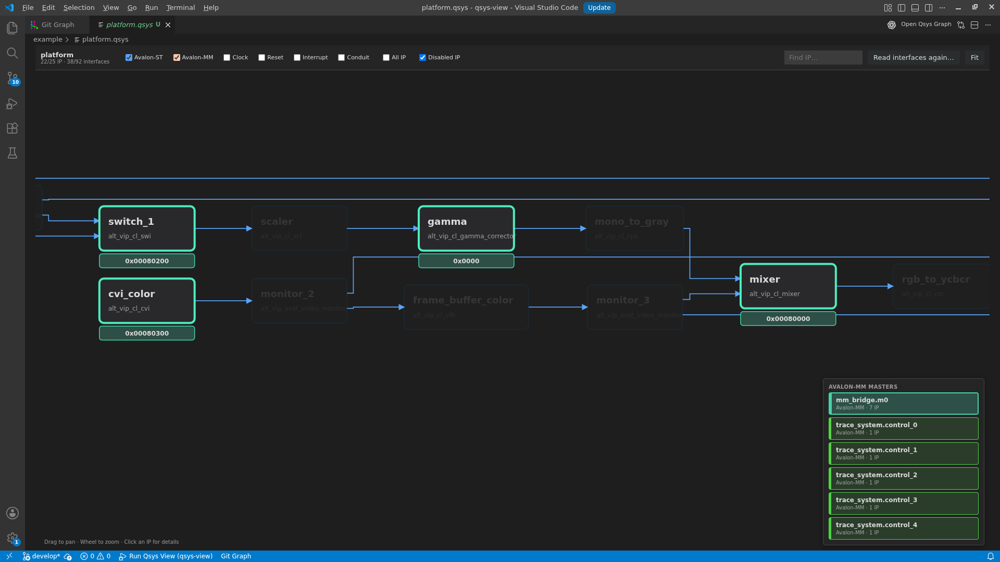

<!--
Copyright 2026 Yaroslav Mariukha
SPDX-License-Identifier: MIT
-->

# Qsys View

Qsys View turns Intel Platform Designer (`.qsys`) files into readable, layered system diagrams directly in Visual Studio Code. Layout is calculated with ELK's Sugiyama-style layered algorithm.

#### Comparison with Platform Designer


#### Avalon-MM base address view



#### Clock domain view


## Installation

Install Qsys View from the Extensions view in Visual Studio Code by searching for `Qsys View`, or run:

```bash
code --install-extension YaroslavMariukha.qsys-view
```

To install a locally packaged `.vsix` file instead, run:

```bash
code --install-extension qsys-view-x.y.z.vsix
```

Alternatively, open the Extensions view in VS Code, select **Views and More Actions… → Install from VSIX…**, and choose the package.

Qsys graph viewing only requires VS Code 1.90 or newer. Intel Quartus Prime is optional and is used only when you explicitly request exact elaborated interface metadata and Avalon-ST waveform examples.

## Features

- Opens `.qsys` files as a read-only graph editor.
- Layered left-to-right automatic layout with orthogonal edge routing.
- Stable Avalon-ST topology: enabling Avalon-MM, clocks, resets, or other links never moves the streaming pipeline.
- Directed edges only for Avalon-ST and conduit connections.
- Interactive hubs for Avalon-MM masters, clock/reset sources, and IRQ receivers.
- Hover a hub to highlight all connected IP; click an MM master to show each slave's relative base address.
- Known clock frequencies are shown directly on their source hubs.
- Separate filters for Avalon-ST, Avalon-MM, clock, reset, interrupt, and conduit interfaces; unknown interfaces are hidden.
- Pan, zoom, and fit-to-window navigation.
- Search by IP instance name or type.
- Optional display of disconnected and disabled IP.
- Click an IP to inspect all parameters stored in the Qsys XML.
- Click a connection or endpoint label to inspect connection and exact elaborated interface parameters.
- Read interface ports and parameters on demand with the installed Quartus `qsys-script`; full platform generation is not required.
- Avalon-ST details include an illustrative transfer waveform based only on the ports and properties returned by Quartus. Multiple symbols use separate physical `data[high:low]` rows; unavailable and zero-width signals are omitted.
- Waveforms can be enlarged from 50% to 400% with buttons or Ctrl+mouse-wheel.
- Automatically refreshes after the source document changes.

By default only Avalon-ST links and their connected modules are shown. Enable **All IP** or more connection types from the toolbar to explore the complete system.

When a system contains Avalon-ST links, they are the structural layer for the graph. Qsys View calculates that pipeline independently and places non-streaming-only IP in a separate stable area. Avalon-MM, clock, reset, and IRQ filters add interactive hubs without adding graph edges or changing node positions. Interface filter changes therefore preserve both Avalon-ST node coordinates and the current pan/zoom position.

## Interface visualization

| Interface | Visualization | Interaction |
| --- | --- | --- |
| Avalon-ST | Directed, orthogonally routed edge | Click for elaborated parameters and an example transfer waveform |
| Conduit | Directed edge | Click for connection parameters |
| Avalon-MM | Master hub | Hover to highlight slaves; click to pin highlighting and show each slave's base address |
| Clock | Source hub | Hover or click to highlight consumers; known source frequency is shown on the hub |
| Reset | Source hub | Hover or click to highlight consumers |
| Interrupt | Receiver hub | Hover or click to highlight interrupt sources |
| Other/unknown | Hidden | Not included in the graph or filters |

## Usage

1. Open a `.qsys` file in VS Code. Qsys View is the default custom editor for this file type.
2. Alternatively, right-click a `.qsys` file and select **Open Qsys Graph**.
3. To inspect raw XML, use **Reopen Editor With… → Text Editor**.
4. Click **Read interfaces…** to read exact interface ports. The extension asks before running IP Tcl, uses a disposable copy in the OS temporary directory, and does not write to the source project.

Qsys View finds `qsys-script` through `QUARTUS_ROOTDIR`, conventional Intel FPGA installation folders, or `PATH`. If necessary, set **Qsys View: Quartus Path**. Local `ip/*/component.ipx`, composition dependencies under `ip/common/**/*_hw.tcl`, the standard Quartus catalog, and paths from **Qsys View: IP Search Paths** are passed to Platform Designer. Relative search paths are resolved from the `.qsys` directory.

## Settings

| Setting | Description |
| --- | --- |
| `qsysView.quartusPath` | Quartus installation directory or direct path to `qsys-script` |
| `qsysView.ipSearchPaths` | Additional Platform Designer IP search paths; `${qsysDir}` and `${workspaceFolder}` are supported |

## Development

Install Node.js 20 or newer (the current LTS release is recommended) and npm. From the repository root, install the exact dependencies recorded in `package-lock.json`:

```bash
npm ci
```

Run individual development checks when needed:

```bash
npm run check
npm test
npm run build
```

`npm run build` only compiles the production JavaScript and CSS files into `dist/`.

Press `F5` in VS Code to launch an Extension Development Host. Open a `.qsys` file there.

To run all checks, tests, the production build, and create an installable package in one command:

```bash
npm run package
```

The resulting file is `qsys-view-<version>.vsix` in the repository root. Install it locally from PowerShell on Windows with:

```powershell
code --install-extension .\qsys-view-<version>.vsix --force
```

Run `npm ci` again only after cloning the repository or when `package-lock.json` changes. For normal rebuilds, `npm run package` is enough.

The extension is published under Marketplace publisher ID `YaroslavMariukha` (display name **Mariukha Yaroslav**). See the [VS Code Marketplace publishing guide](https://code.visualstudio.com/api/working-with-extensions/publishing-extension) for release instructions.

## Current scope

Qsys View never writes to `.qsys` files or the project directory. Basic graph data comes from XML. Exact interface properties come only from a fresh, user-triggered `qsys-script` elaboration of a temporary copy; `.sopcinfo` is not read and metadata is not cached. If Quartus or an IP definition cannot be resolved, no waveform is shown. Waveforms are illustrative protocol examples, not simulation output.

## License

MIT
