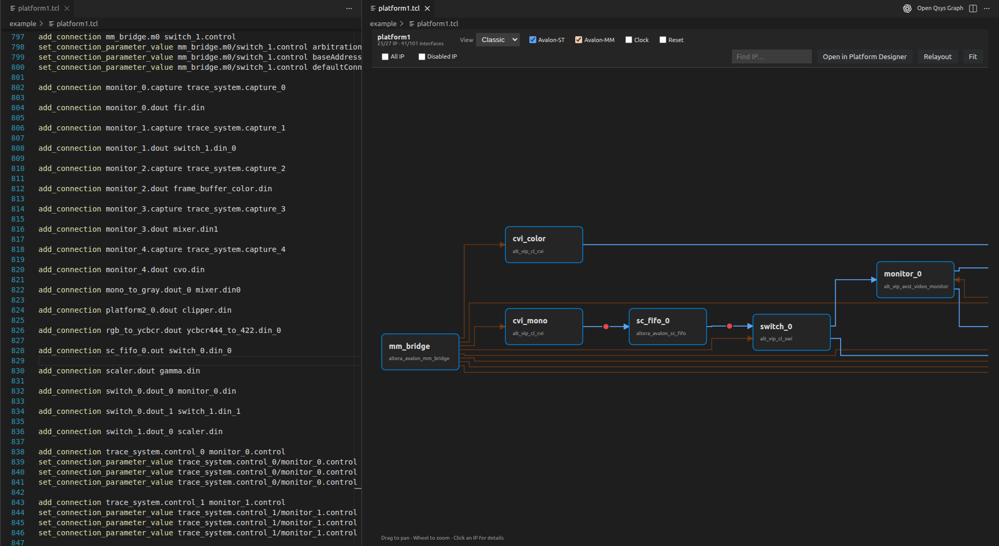

<!--
Copyright 2026 Yaroslav Mariukha
SPDX-License-Identifier: MIT
-->

# Qsys View

Qsys View is a read-only Visual Studio Code viewer for Intel Platform Designer systems. It opens `.qsys` files and exported Platform Designer `.tcl` scripts as compact layered graphs.

Open tcl with Qsys View:


Show base addresses:


and much more!

## What it does

- Opens `.qsys` directly and `.tcl` through **Reopen Editor With… → Qsys TCL Graph**.
- Keeps hierarchical subsystems collapsed as single IP blocks.
- Expands a selected subsystem in place, enters it in the same canvas, or opens it in a new editor without automatically expanding deeper levels.
- Draws a left-to-right graph with orthogonal connections.
- Shows IP and connection parameters on click.
- Groups configured IP parameters by their Platform Designer sections after Quartus interface analysis.
- Highlights clock, reset, Avalon-MM, and interrupt domains without filling the graph with their edges.
- Draws multi-slave Avalon-MM masters as shared buses in Classic view while keeping each branch inspectable.
- Detects Avalon-ST adapters after Quartus analysis and marks them with a red dot.
- Shows elaborated interface ports, parameters, and an illustrative Avalon-ST waveform.
- Updates a Tcl graph without moving existing IP or rerouting unchanged connections.
- Adds new IP below the frozen graph; **Relayout** recalculates positions without discarding Quartus analysis.
- Reloads the source hierarchy and sourced configuration explicitly with **Reload source**.
- Reports static Tcl parser problems and opens the source line from the problems list.
- Opens Qsys directly in Platform Designer or converts Tcl in a disposable sibling folder first.

## Views and interfaces

Qsys View has two modes:

| Interface | Pipeline | Classic |
| --- | --- | --- |
| Avalon-ST | Directed edge and layout anchor | Directed edge |
| Conduit | Directed edge | Directed edge |
| Avalon-MM | Highlight hub | Shared bus or directed edge |
| Interrupt | Highlight hub | Directed edge |
| Clock | Highlight hub | Highlight hub |
| Reset | Highlight hub | Highlight hub |
| Other or unknown | Hidden | Grey directed edge |

Only interface filters present in the current system are shown. Pipeline layout is anchored exclusively by Avalon-ST when streaming connections exist. For exported Tcl, Pipeline remains disabled until **Read interfaces…** resolves the real interface types for every visible hierarchy level.

The Tcl reader accepts Platform Designer declarations for `avalon`, `axi`, `tristate_conduit`, `avalon_streaming`, `interrupt`, `conduit`, `clock`, `reset`, and `nios_custom_instruction`. Before Quartus analysis, Avalon-MM is also recognized from exported connection properties such as `baseAddress` and `arbitrationPriority`; unrelated unknown connections remain grey.

## Tcl and Quartus analysis

In a trusted workspace, Qsys View automatically runs the system in a restricted safe `tclsh` interpreter. Platform Designer commands only record their resolved arguments, so `source`, namespaces, procedures, substitutions, `if`, `switch`, and loops appear immediately without starting Quartus. File access and external commands remain blocked; sourced Tcl is restricted to the current workspace and the resolver has a short timeout. If `tclsh` is unavailable or the script needs unsupported capabilities, Qsys View falls back to the lexical reader and reports a warning.

The **Read interfaces…** action still runs `qsys-script` on demand. Use it when exact elaborated interfaces, ports, streaming formats, or automatic adapters are required.

Use `qsysView.tclVariables` to select a configuration before evaluation or before opening the Tcl system in Platform Designer. For example:

```json
{
  "qsysView.tclVariables": {
    "PLATFORM_CONFIG": "WHC"
  }
}
```

**Infer clk/reset** classifies only unknown static Tcl connections by interface names. It recognizes `clock`, `clk`, `reset`, `reset_n`, `rst`, `rst_n`, `nrst`, and `rstn`. Reset takes priority for names such as `clk_reset`. Disable the checkbox if a project uses those words for unrelated interfaces. Explicit Qsys/Tcl kinds and Quartus results are never overridden.

Quartus analysis is user-triggered and runs on a disposable copy. It supplies exact types and ports, Avalon-ST format information, and automatic-adapter detection. While this metadata is current, **Read interfaces…** and **Infer clk/reset** are hidden. Editing any loaded source invalidates its metadata and shows the controls again. The source file is never modified.

## Hierarchical systems

When an IP type matches a sibling `.qsys` or `.tcl` file, its block has a **+** control. Expanding replaces only that instance with its internal graph, reconnects parent links through exported interfaces, and surrounds the child with a dashed container kept clear of top-level IP. Use **−** to collapse the container or **↘** to enter it as the full canvas.

If the parent was read with **Read interfaces…**, expanded children are analyzed too. Nested Tcl connections therefore keep their exact interface types in Pipeline view, while exported clock and reset bridges remain part of the parent domain.

Choose **Enter subsystem** in the IP details to navigate within the current viewer; **← Back** restores the parent layout and zoom. Choose **Open in new editor**, or double-click the block, for a separate Qsys View. Nested children remain collapsed and can be expanded independently.

## Controls

- **View** switches between Classic and Pipeline.
- **All IP** includes IP without visible functional connections; off by default. Clock/reset highlighting alone does not make an IP visible.
- **Disabled IP** includes disabled instances; off by default.
- **Infer clk/reset** controls name inference; on by default.
- **Errors/Warnings** appears when the static Tcl reader finds a problem; click an item to open its source line.
- **+** expands a detected subsystem; **−** collapses its container; **↘** enters it; **← Back** returns to the parent.
- **Read interfaces…** requests exact Quartus metadata.
- **Open in Platform Designer** opens or converts the system.
- **Reload source** rereads the active Qsys/Tcl hierarchy, including sourced configuration files, and invalidates stale Quartus analysis.
- **Relayout** recalculates the active layout while preserving analysis; **Fit** fits it to the viewport.
- Drag to pan, use the wheel to zoom, and search by instance name or IP type.

New viewers start in Classic mode. With **Remember Last View State** enabled, Qsys View reuses the last mode, interface filters, IP visibility options, and name-inference choice across editors.

## Installation

Install **Qsys View** from the VS Code Extensions view, or run:

```bash
code --install-extension YaroslavMariukha.qsys-view
```

A local package can be installed with:

```bash
code --install-extension qsys-view-1.0.6.vsix --force
```

## Settings

| Setting | Purpose |
| --- | --- |
| `qsysView.quartusPath` | Quartus directory or direct path to `qsys-script` |
| `qsysView.platformDesignerPath` | Direct path to `qsys-edit` or `qsys.exe` |
| `qsysView.ipSearchPaths` | Additional Platform Designer IP search paths |
| `qsysView.tclVariables` | Global variables set before evaluating a Tcl system |
| `qsysView.tclshPath` | Tcl interpreter used for automatic safe control-flow resolution |
| `qsysView.rememberLastViewState` | Remember toolbar choices across editors |

## Development

Node.js 20 or newer is required.

```bash
npm ci
npm test
npm run check
npm run package
```

`npm run package` creates `qsys-view-<version>.vsix`. Press `F5` in VS Code to run an Extension Development Host.

## Scope

Qsys View does not edit Qsys or Tcl sources and its static diagnostics do not replace Platform Designer validation. Unknown Tcl connections remain grey in Classic mode until their type is explicit, inferred, or resolved by Quartus. Waveforms are protocol illustrations, not simulation output.

## License

MIT
