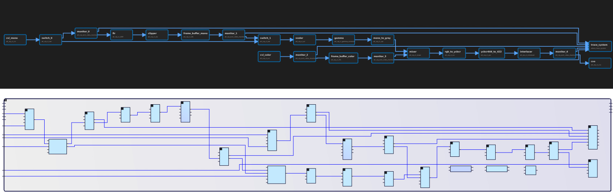
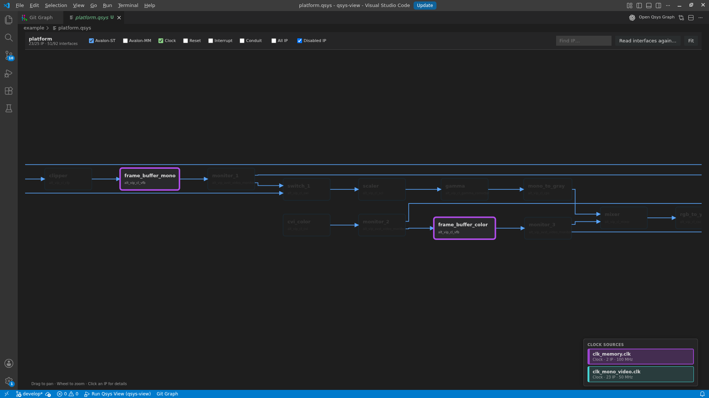
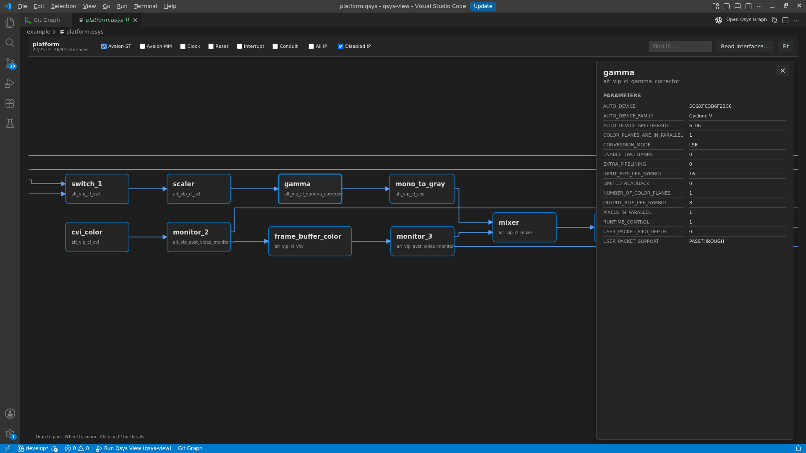
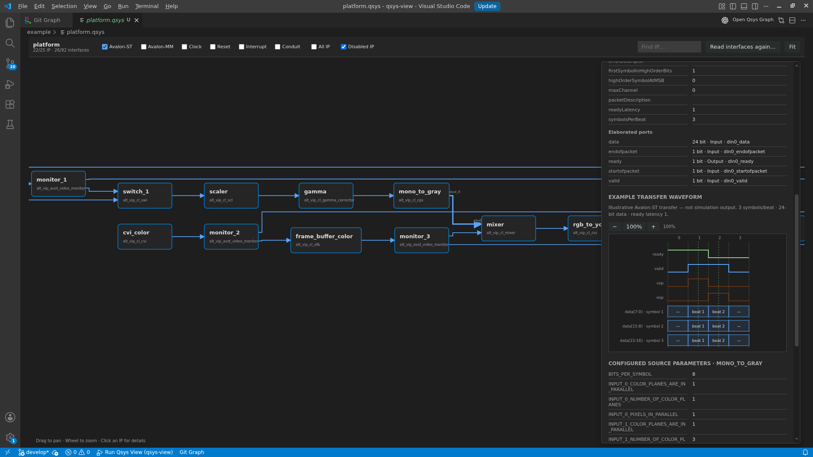

<!--
Copyright 2026 Yaroslav Mariukha
SPDX-License-Identifier: MIT
-->

# Qsys View

Qsys View turns Intel Platform Designer systems into readable, layered diagrams directly in Visual Studio Code. It opens `.qsys` files and exported Platform Designer `.tcl` scripts without modifying them. Layout is calculated with ELK's Sugiyama-style layered algorithm.

#### Comparison with Platform Designer



#### Avalon-MM base address view


#### Clock domain view



#### IP parameters



#### Elaborated interface details



## Installation

Install Qsys View from the Extensions view in Visual Studio Code by searching for `Qsys View`, or run:

```bash
code --install-extension YaroslavMariukha.qsys-view
```

To install a locally packaged `.vsix` file instead, run:

```bash
code --install-extension qsys-view-x.y.z.vsix
```

Alternatively, open the Extensions view in VS Code, select **Views and More Actions… → Install from VSIX…**, and choose the package.

Static graph viewing only requires VS Code 1.90 or newer. Intel Quartus Prime is optional and runs only when you explicitly request exact elaborated interface metadata, adapter detection, and Avalon-ST waveform examples.

## Features

- Opens `.qsys` files as a read-only graph editor and exported Platform Designer `.tcl` files as an optional editor.
- Layered left-to-right automatic layout with orthogonal edge routing.
- **Pipeline** view keeps Avalon-ST as the structural graph when a streaming pipeline is present. Avalon-MM, clock, reset, and interrupt interfaces use compact hubs.
- **Complete** view draws Avalon-ST, Avalon-MM, interrupt, conduit, and unknown connections as edges. Clocks and resets remain compact hubs to avoid visual clutter.
- Separate filter selections are retained for Pipeline and Complete views.
- Hover a hub to highlight all connected IP; click an MM master to show each slave's relative base address.
- Known clock frequencies are shown directly on their source hubs.
- Connections whose type cannot be determined are shown in grey.
- A red dot marks an Avalon-ST connection for which Quartus will insert timing, data-format, channel, or error adaptation. Hover or click the connection to see the endpoint differences.
- Pan, zoom, and fit-to-window navigation.
- Search by IP instance name or type.
- Optional display of disconnected and disabled IP.
- Click an IP to inspect all parameters stored in the Qsys XML.
- Click a connection or endpoint label to inspect connection and exact elaborated interface parameters.
- Read interface ports and parameters on demand with the installed Quartus `qsys-script`; full platform generation is not required.
- Avalon-ST details include an illustrative transfer waveform based only on the ports and properties returned by Quartus. Multiple symbols use separate physical `data[high:low]` rows; unavailable and zero-width signals are omitted.
- Waveforms can be enlarged from 50% to 400% with buttons or Ctrl+mouse-wheel.
- Hierarchical Platform Designer subsystems stay collapsed as individual IP blocks.
- Automatically refreshes after the source document changes.

By default Qsys View starts in **Pipeline** view with Avalon-ST and unknown links enabled. Enable **All IP**, select more connection types, or switch to **Complete** view to explore the rest of the system.

When Pipeline view contains at least one Avalon-ST link, Qsys View calculates that pipeline independently and places non-streaming-only IP in a separate stable area. Enabling hub interfaces does not add graph edges or change node positions. Systems without Avalon-ST links use the normal layered layout. Complete view always uses the full set of direct connections for layout.

## Interface visualization

| Interface | Pipeline view | Complete view |
| --- | --- | --- |
| Avalon-ST | Directed edge | Directed edge |
| Conduit | Directed edge | Directed edge |
| Avalon-MM | Master hub | Directed edge |
| Clock | Source hub | Source hub |
| Reset | Source hub | Source hub |
| Interrupt | Receiver hub | Directed edge |
| Other/unknown | Grey directed edge | Grey directed edge |

Click an edge to inspect its connection and endpoint parameters. Avalon-ST details can include an illustrative transfer waveform and detected automatic adapters. Hover a hub to highlight related IP; click it to pin the highlighting. An Avalon-MM master hub also shows each slave's relative base address.

## Usage

1. Open a `.qsys` file in VS Code. Qsys View is the default custom editor for this file type.
2. For an exported Platform Designer `.tcl` file, use **Reopen Editor With… → Qsys TCL Graph** or right-click it and select **Open Qsys Graph**. Qsys View intentionally does not replace the normal editor for every Tcl file.
3. Use the **View** selector to switch between Pipeline and Complete layouts.
4. To inspect the source, use **Reopen Editor With… → Text Editor**.
5. Click **Read interfaces…** to read exact interface types, ports, and parameters. The extension asks before running IP Tcl, works on a disposable copy in the OS temporary directory, and does not write to the source project.

The static Tcl reader supports exported, declarative Platform Designer commands such as `add_instance`, `set_instance_parameter_value`, `add_connection`, and `set_connection_parameter_value`. It does not evaluate arbitrary Tcl expressions or source other scripts. Until Quartus elaborates the system, Tcl connection types are therefore intentionally shown as unknown grey links.

Qsys View finds `qsys-script` through `QUARTUS_ROOTDIR`, conventional Intel FPGA installation folders, or `PATH`. If necessary, set **Qsys View: Quartus Path**. Local `ip/*/component.ipx`, composition dependencies under `ip/common/**/*_hw.tcl`, the standard Quartus catalog, and paths from **Qsys View: IP Search Paths** are passed to Platform Designer. Relative search paths are resolved from the `.qsys` directory.

## Settings

| Setting | Description |
| --- | --- |
| `qsysView.quartusPath` | Quartus installation directory or direct path to `qsys-script` |
| `qsysView.ipSearchPaths` | Additional Platform Designer IP search paths; `${qsysDir}` and `${workspaceFolder}` are supported |

## Development

Install Node.js 20 or newer (the current LTS release is recommended) and npm. From the repository root, install the exact dependencies recorded in `package-lock.json`:

```bash
npm ci
```

Run individual development checks when needed:

```bash
npm run check
npm test
npm run build
```

`npm run build` only compiles the production JavaScript and CSS files into `dist/`.

Press `F5` in VS Code to launch an Extension Development Host. Open a `.qsys` file or reopen an exported `.tcl` file with the Qsys TCL Graph editor there.

To run all checks, tests, the production build, and create an installable package in one command:

```bash
npm run package
```

The resulting file is `qsys-view-<version>.vsix` in the repository root. Install it locally from PowerShell on Windows with:

```powershell
code --install-extension .\qsys-view-<version>.vsix --force
```

Run `npm ci` again only after cloning the repository or when `package-lock.json` changes. For normal rebuilds, `npm run package` is enough.

The extension is published under Marketplace publisher ID `YaroslavMariukha` (display name **Mariukha Yaroslav**). See the [VS Code Marketplace publishing guide](https://code.visualstudio.com/api/working-with-extensions/publishing-extension) for release instructions.

## Current scope

Qsys View never writes to `.qsys`/`.tcl` source files or the project directory. Basic graph data comes from Qsys XML or static Tcl commands. Exact interface properties and automatic-adapter annotations come only from a fresh, user-triggered `qsys-script` elaboration in a temporary directory; `.sopcinfo` is not read and metadata is not cached. If Quartus or an IP definition cannot be resolved, unknown connections remain grey and no waveform or adapter annotation is shown. Waveforms are illustrative protocol examples, not simulation output.

## License

MIT
